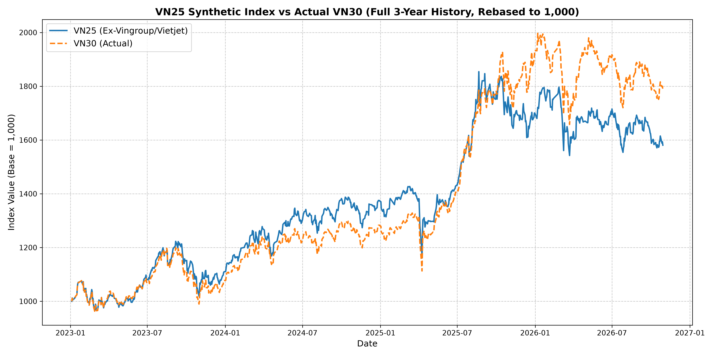

# VN25 Index

A custom Vietnamese equity index that strips Vingroup and Vietjet stocks from the VN30, revealing how much these five tickers inflate Vietnam's headline benchmark.



## Why VN25?

Vietnam's benchmark **VN30 Index** allocates a disproportionate weight to five tickers tied to a single conglomerate — **Vingroup** (VIC, VHM, VRE, VPL) and its affiliate **Vietjet** (VJC). When these stocks rally, the VN30 can signal a healthy market even when the majority of its constituents are flat or declining. The index becomes a mirror of one corporate group's performance, not the broader Vietnamese economy.

**VN25 permanently excludes those five tickers** and re-weights the remaining 25 constituents using free-float market-cap weighting with a **10% per-stock cap**. The goal is not to build a "better" index — it's to expose the gap between what the VN30 says and what the rest of the market is actually doing.

## Methodology

| Parameter | Detail |
|---|---|
| **Universe** | VN30 constituents (quarterly rebalanced by HOSE) |
| **Exclusions** | VIC, VHM, VRE, VPL, VJC |
| **Weighting** | Free-float market-cap weighted |
| **Single-stock cap** | 10% at each rebalance |
| **Rebalance frequency** | Quarterly (aligned with HOSE schedule) |
| **Base value** | 1,000 |
| **History** | Jan 2023 – present (~3 years) |

### Weight-Capping Algorithm

At each quarterly rebalance:
1. Compute raw weights from `free_float_pct × shares_for_index × close_price`
2. Cap any stock exceeding 10%
3. Redistribute excess weight pro-rata among uncapped stocks
4. Repeat until no stock breaches the cap

## Results

The chart tells the story. From Jan 2023 through mid-2025, VN25 and VN30 tracked each other closely — the Vingroup/Vietjet stocks weren't moving the needle. But from mid-2025 onward, the two indices **diverge sharply**: VN30 surges while VN25 stalls and declines.

That divergence is the point. The VN30's gains in this period were **driven almost entirely by the five excluded mega-caps**. Strip them out and the remaining 25 stocks — which represent the broader Vietnamese large-cap market — show a market that has actually been losing ground.

This confirms the core thesis: **the VN30 can paint a misleadingly optimistic picture of Vietnam's equity market.** When a handful of Vingroup-affiliated tickers rally, the headline index rises even as the majority of its constituents trend downward. VN25 makes that distortion visible.

## Project Structure

```
vn25-index/
├── 02_fetch_historical_prices.py   # Fetch daily OHLCV for all VN30 tickers via vnstock
├── 03_simulate_vn25.py             # Build the VN25 index (exclude, weight, cap, chain-link)
├── 04_analyze_vn25_vs_vn30.py      # Compare VN25 vs real VN30 — metrics & chart
├── data/
│   ├── vn30_freefloat_history.csv  # Quarterly VN30 basket composition & free-float data
│   ├── vn25_historical_index.csv   # Output: daily VN25 index values
│   ├── vn25_daily_weights.csv      # Output: daily constituent weights
│   └── prices/                     # Daily OHLCV per ticker (ACB.csv, FPT.csv, …)
├── vn25_vs_vn30_chart.png          # Performance comparison chart
├── requirements.txt
├── LICENSE
└── README.md
```

## Pipeline

The pipeline is streamlined into three scripts:

### `02_fetch_historical_prices.py` — Data Ingestion

Reads the unique tickers from `data/vn30_freefloat_history.csv` and downloads daily OHLCV data for each one using the [`vnstock`](https://github.com/thinh-vu/vnstock) library (v0.2.x legacy API). Output is saved as one CSV per ticker under `data/prices/`.

### `03_simulate_vn25.py` — Index Construction

The core script. For each quarterly rebalance period:
- Loads the VN30 basket composition and daily prices
- Excludes the five Vingroup/Vietjet tickers
- Computes free-float market-cap weights with iterative 10% capping
- Chain-links daily returns to build a continuous index series (base = 1,000)

Outputs `data/vn25_historical_index.csv` and `data/vn25_daily_weights.csv`.

### `04_analyze_vn25_vs_vn30.py` — Analysis & Visualization

Fetches the real VN30 index, rebases both series to 1,000, and generates:
- A side-by-side performance chart (`vn25_vs_vn30_chart.png`)
- Key metrics: total return, annualized return, annualized volatility, max drawdown

## Getting Started

### Prerequisites

- Python 3.9+
- pip

> **Important:** This project uses `vnstock==0.2.8.2` (the legacy API). Newer versions (v4+) use a different API syntax and enforce strict rate limits that will break the data ingestion script. The pinned version in `requirements.txt` handles this automatically.

### Installation

```bash
git clone https://github.com/havinguy/vn25-index.git
cd vn25-index
pip install -r requirements.txt
```

### Usage

Run the scripts in order:

```bash
# 1. Download historical price data
python 02_fetch_historical_prices.py

# 2. Build the VN25 index
python 03_simulate_vn25.py

# 3. Generate comparison chart & metrics
python 04_analyze_vn25_vs_vn30.py
```

The performance chart will be saved as `vn25_vs_vn30_chart.png` in the project root.

## Data Sources

- **VN30 basket composition & free-float data** (`data/vn30_freefloat_history.csv`) — Manually compiled from official quarterly HOSE regulatory PDF disclosures. Each row records a ticker's inclusion in the VN30 basket, its shares outstanding for index calculation, and its free-float percentage at each quarterly rebalance date. This static file serves as the seed for the entire pipeline.
- **Daily OHLCV prices** — [`vnstock`](https://github.com/thinh-vu/vnstock) v0.2.x (Python wrapper for Vietnamese market data, using the legacy unrestricted API)

## Limitations

- Free-float percentages are sourced from HOSE regulatory disclosures and may lag actual changes
- The index does not account for dividends (price-return only)
- Transaction costs and slippage from rebalancing are not modeled
- `vnstock` API availability may vary; historical data coverage depends on the upstream provider
- The project is pinned to `vnstock==0.2.8.2`; future API deprecation may require migration

## License

This project is licensed under the MIT License — see the [LICENSE](LICENSE) file for details.
